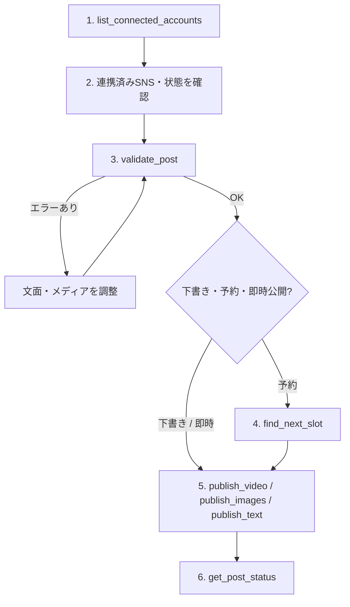

<!-- 日本語版（参考）。エージェントが優先して読むのは SKILL.md（英語）です。内容は SKILL.md と同じに保っています。最終更新: 2026-11-20 -->

# PublishOnce エージェントスキル

PublishOnce（`https://publishonce.app`）は、AI エージェントと開発者向けの統合 SNS 投稿・予約・分析プラットフォームです。**LINE 公式アカウント** へのネイティブ対応をはじめ、**YouTube Shorts・TikTok・LinkedIn・Bluesky・Pinterest・X (Twitter)・Mastodon・WordPress・Telegram・Discord・Slack**、および審査中の **Instagram・Facebook・Threads・Google ビジネス プロフィール** まで **全16プラットフォーム** に動画・画像・テキストを一括配信できます。

## 主な機能
1. **マルチプラットフォーム一括配信（`video` / `image` / `text`）**: 動画・画像・テキストを最大16SNSへ同時に下書き・予約・公開。
2. **安全な下書きデフォルト（`publish_mode`）**: 既定値は `"draft"`（各SNSの下書き・非公開・コンテナ保留として安全に入稿）。本番公開するときのみ `"direct"` を明示します。
3. **SNSごとの文面・タイトル最適化（`caption_overrides` / `title_overrides`）**: 1回のリクエストで、X 向けの短文、YouTube 向けの検索タイトル・説明文、Instagram 向けのハッシュタグ等を出し分け可能。
4. **アルゴリズム対策のファーストコメント（`first_comment` / `follow_ups`）**: 本文に外部 URL を入れず、公開直後の1件目コメント（および最大4件の続きスレッド）へ自動で URL を逃がせます。
5. **事前バリデーション（`validate_post` / `validate_video`）**: 投稿前に文字数・動画尺・アスペクト比・ファイルサイズ上限をチェック。
6. **最適スロット検索（`find_next_slot`）**: 連携アカウント全体の空き予約枠を自動取得。
7. **分析・エンゲージメント・承認リンク**: インサイト取得、コメント閲覧・返信・非表示、外部確認用リンク（`create_review_link`）の発行。

---

## 3つの利用方法

| 方法 | 向いている用途 | 入口 |
| :--- | :--- | :--- |
| **1. Hosted MCP サーバー** | AI エージェント（Claude / Cursor / Antigravity 等） | `list_connected_accounts`, `validate_post`, `publish_*` |
| **2. REST API（`/api/v1`）** | 自社アプリ・ComfyUI ノード・スクリプト・n8n | `https://publishonce.app/api/v1`（`Bearer po_live_...`） |
| **3. 付属 CLI（ゼロ依存）** | ターミナル・ローカルスクリプト（Node.js 18+） | `./scripts/publishonce.js`（すべて JSON 出力） |

API キーは `https://publishonce.app/settings/api` で発行できます：
- `po_live_...`: 本番キー（実際に下書き作成・投稿を実行）
- `po_test_...`: テストキー（SNS へは送らず成功レスポンスのみ返す）
- **API キーを画面・ログ・チャットへ絶対に出力しないこと。**

---

## エージェントの標準ワークフロー（MCP）



1. **アカウント確認（`list_connected_accounts`）**: 連携中の `platform` と `id`（UUID）、トークン状態（`expired` の場合は再連携を案内）を確認。
2. **事前検証（`validate_post` / `validate_video`）**: `platforms`・`text`・`media_type` を渡して制限違反がないか確認。
3. **予約枠取得（`find_next_slot`）**: 予約投稿の場合、ISO 8601（UTC）の `scheduled_at` を取得。
4. **作成・公開（`publish_video` / `publish_images` / `publish_text` / `publish_campaign`）**:
   - `publish_mode`: `"draft"`（既定・推奨）または `"direct"`（本番公開）
   - `caption_overrides`: `{ "<platform>": "<SNS別本文>" }`
   - `title_overrides`: `{ "<platform>": "<SNS別タイトル>" }`（`youtube`, `pinterest`, `facebook`, `linkedin`）
   - `first_comment`: 公開直後の1件目コメント（`youtube`, `instagram`, `facebook`, `threads`, `bluesky`, `x`）
   - `follow_ups`: 追加スレッド最大4件（`instagram`, `facebook`, `threads`, `bluesky`）
5. **結果確認（`get_post_status`）**: `post_id` から各 SNS のステータス（`published` / `scheduled` / `draft` / `failed`）と公開 URL を確認。

---

## REST API クイックリファレンス

Base URL: `https://publishonce.app/api/v1`  
認証ヘッダー: `Authorization: Bearer YOUR_API_KEY`

- `GET /connections` — 連携アカウント一覧
- `GET /platforms/capabilities` — 有効な全SNSの機能マトリクス
- `GET /platforms/{platform}/requirements` — SNS別の動画規格・制約
- `POST /uploads` — 動画・画像の事前アップロード
- `POST /posts` — 下書き・即時投稿・予約投稿の作成
- `GET /posts/{id}` — 投稿ステータス・各SNS結果の取得

### 実行例：SNS別文面最適化＋ファーストコメント（REST API）
```bash
curl -X POST "https://publishonce.app/api/v1/posts" \
  -H "Authorization: Bearer YOUR_API_KEY" \
  -H "Content-Type: application/json" \
  -d '{
    "post_type": "text",
    "publish_mode": "draft",
    "platforms": ["x", "linkedin", "bluesky"],
    "caption": "複数SNSへの投稿と最適化を1か所で完結。",
    "caption_overrides": {
      "x": "SNSごとに毎回コピペしてませんか？各SNS向けに最適化した投稿を1回で配信できます。",
      "bluesky": "複数SNSへの最適化配信とファーストコメントをAPIで自動化。",
      "linkedin": "REST API / MCP によるマルチプラットフォームSNS配信の効率化。"
    },
    "first_comment": "詳細はこちら: https://publishonce.app"
  }'
```
※ 実際に本番公開する場合のみ `"publish_mode": "direct"` を指定してください。

---

## 付属 CLI クイックリファレンス（`./scripts/publishonce.js`）

Node.js 18+ で動くゼロ依存 CLI（JSON 出力）：
```bash
./scripts/publishonce.js setup --key po_live_xxxxxxxx --global
./scripts/publishonce.js connections [--platform youtube]
./scripts/publishonce.js media upload ./video.mp4
./scripts/publishonce.js posts create --data-file post.json
./scripts/publishonce.js posts publish <id>
./scripts/publishonce.js posts list --limit 20
```

---

## 全16プラットフォームの公開状況・制約一覧

### ✅ 即時利用可能（12プラットフォーム）
| SNS | 投稿形式 | 最大文字数 | 画像上限 | 主な機能・備考 |
|---|---|---|---|---|
| **YouTube Shorts** | 動画 | 5,000（タイトル 100） | - | `first_comment`・サムネイル画像・成果履歴に対応 |
| **TikTok** | 動画 | 2,200 | - | `cover_frame`（秒数指定）・TikTok下書き受信箱（`send_as_draft`）対応 |
| **LinkedIn** | 動画・画像・テキスト | 3,000 | 20枚 | 個人プロフィール＆会社ページ・サムネイル画像・削除対応 |
| **Bluesky** | 動画・画像・テキスト | 300 | 4枚（1MB/枚） | `first_comment`・`follow_ups`・コメント返信・インサイト・削除対応 |
| **Pinterest** | 動画・画像 | 500（タイトル 100） | 5枚 | `board_id` 必須・サムネイル・カバー指定・削除対応 |
| **X (Twitter)** | 動画・画像・テキスト | 280 | 4枚（5MB/枚） | 公式枠（Free: 0 / Starter: 月20 / PRO: 月40 / Enterprise: 無制限）または自前キー（BYOK）で無制限。`first_comment` 対応 |
| **Mastodon** | 動画・画像・テキスト | 500〜 | 4枚（16MB/枚） | カスタムインスタンス・投稿削除対応 |
| **WordPress** | 動画・画像・テキスト | 63,206 | 20枚 | REST API v2（Gutenberg ブロック投稿） |
| **LINE公式** | 動画・画像・テキスト | 5,000 | 5枚 | 日本・アジア向けネイティブ連携＆通知カード配信 |
| **Telegram** | 動画・画像・テキスト | 4,096 | 10枚 | チャンネル/グループへ Chat ID で配信・削除対応 |
| **Discord** | 動画・画像・テキスト | 2,000 | 10枚 | Webhook / チャンネル配信・削除対応 |
| **Slack** | 動画・画像・テキスト | 5,000 | 5枚 | Incoming Webhook / Block Kit 配信・通知 |

### ⏳ 公式審査中（登録テストアカウントのみ利用可：4プラットフォーム）
| SNS | 状態 | 投稿形式 | 最大文字数 | 主な機能 |
|---|---|---|---|---|
| **Instagram Reels** | Meta公式審査中 | 動画・画像 | 2,200（画像10枚） | `first_comment`・`follow_ups`・コメント返信/非表示・インサイト・サムネイル |
| **Facebook** | Meta公式審査中 | 動画・画像・テキスト | 63,206（画像10枚） | `first_comment`・`follow_ups`・コメント返信・インサイト・削除・サムネイル |
| **Threads** | Meta公式審査中 | 動画・画像・テキスト | 500（画像20枚） | `first_comment`・`follow_ups`・コメント返信/非表示・インサイト・削除 |
| **Google ビジネス** | Google公式審査中 | 動画・画像・テキスト | 1,500（画像10枚） | 最新情報・写真/動画の店舗投稿 |

---

## 安全運用ルール（エージェント必須事項）
1. **Connection ID を推測しない**: 必ず `list_connected_accounts` / `GET /connections` の結果を使う。
2. **本番公開前の明示的な承認**: 既定の `publish_mode: "draft"` で安全に作成し、投稿先アカウント・本文・予約時刻の承認を得てから `"direct"` を使う。
3. **URL は `first_comment` へ**: リーチ低下を防ぐため、`x` / `instagram` / `facebook` / `threads` / `bluesky` / `youtube` では本文に URL を書かず `first_comment` を活用する。
4. **チーム確認には承認リンク**: 外部チェックが必要な場合は `create_review_link` で承認用 URL を発行する。
