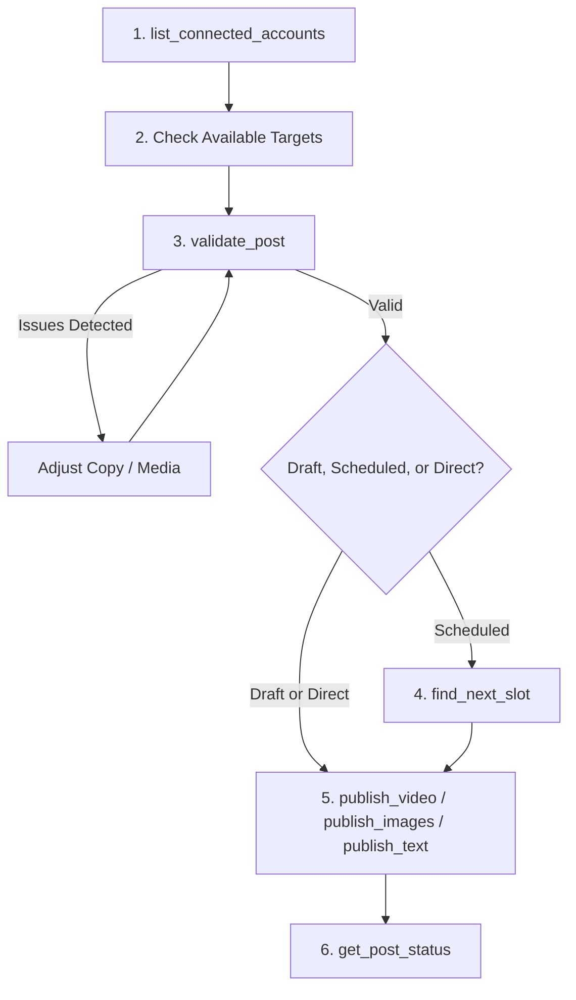

# PublishOnce Agent Skill

PublishOnce (`https://publishonce.app`) is a unified social media publishing, scheduling, and analytics platform built for AI agents and developers. It supports **16 platforms** across `video`, `image`, and `text` posts, with native **LINE Official Account** integration alongside **YouTube Shorts, TikTok, LinkedIn, Bluesky, Pinterest, X (Twitter), Mastodon, WordPress, Telegram, Discord, Slack**, and **Instagram / Facebook / Threads / Google Business Profile**.

## Core Capabilities
1. **Multi-Platform Dispatch (`video` / `image` / `text`)**: Publish or schedule across up to 16 platforms in one workflow.
2. **Safe Draft Default (`publish_mode`)**: Defaults to `"draft"` (saves as draft / unlisted / container hold on supported platforms) unless `"direct"` is explicitly specified.
3. **Per-Platform Optimization (`caption_overrides` & `title_overrides`)**: Customize copy, hashtags, and titles per network in a single call.
4. **Algorithm-Friendly First Comments (`first_comment` & `follow_ups`)**: Keep external URLs out of the main caption and place them in the first comment automatically.
5. **Preflight Validation (`validate_post` / `validate_video`)**: Verify text lengths, video specs, and platform rules before dispatching.
6. **Smart Slot Discovery (`find_next_slot`)**: Automatically find the next open queue slot across connected accounts.
7. **Engagement, Review & Analytics**: Manage comments/replies, generate human approval links (`create_review_link`), and fetch post insights.

---

## Integration Modes (Choose One)

| Mode | Best For | Entry Point |
| :--- | :--- | :--- |
| **1. Hosted MCP Server** | AI agents (Claude, Cursor, Antigravity, etc.) | `list_connected_accounts`, `validate_post`, `publish_*` |
| **2. REST API (`/api/v1`)** | Custom apps, ComfyUI nodes, scripts, n8n | `https://publishonce.app/api/v1` (`Bearer po_live_...`) |
| **3. Bundled CLI** | Quick terminal workflows (Node.js 18+) | `./scripts/publishonce.js` (JSON stdout) |

API Keys can be created at `https://publishonce.app/settings/api`:
- `po_live_...`: Production key (creates real drafts/posts).
- `po_test_...`: Test key (simulates success without publishing to social networks).
- Never print or log API keys.

---

## Standard Workflow for Autonomous Agents (MCP)



### Step 1: Discover Active Accounts
Always call `list_connected_accounts` first to verify connected platforms, `id` (UUID for `connection_ids`), and token health (`expired` requires reconnection in Settings).

### Step 2: Preflight Validation
Run `validate_post` (and `validate_video` for videos) before submitting:
- **Arguments**: `platforms` (array), `text` (caption), `media_type` (`"video"`, `"image"`, or `"none"`).

### Step 3: Find Optimal Time Slot (For Scheduling)
Call `find_next_slot` with `platforms` or `connection_ids` to get an ISO 8601 UTC `scheduled_at` timestamp.

### Step 4: Draft, Publish, or Schedule
Choose the matching tool:
- **Video**: `publish_video` / `schedule_video` (public `video_url` or uploaded path via `create_video_upload`)
- **Images**: `publish_images` (1–20 images depending on platform)
- **Text Only**: `publish_text`
- **Multi-Asset Batch**: `publish_campaign`

Key optional parameters:
- `publish_mode`: `"draft"` (default, safe draft/hold) or `"direct"` (live publish/schedule).
- `caption_overrides`: `{ "<platform>": "<custom caption>" }` to tailor copy per network.
- `title_overrides`: `{ "<platform>": "<custom title>" }` (`youtube`, `pinterest`, `facebook`, `linkedin`).
- `first_comment`: Auto-posted right after publishing on `youtube`, `instagram`, `facebook`, `threads`, `bluesky`, and `x`.
- `follow_ups`: Up to 4 additional thread/follow-up comments on `instagram`, `facebook`, `threads`, and `bluesky`.

### Step 5: Verify Execution
Call `get_post_status` with `post_id` to inspect per-platform status (`published`, `scheduled`, `draft`, `failed`) and permalinks.

---

## REST API Quick Reference

Base URL: `https://publishonce.app/api/v1`  
Header: `Authorization: Bearer YOUR_API_KEY`

- `GET /connections` — List connected social accounts
- `GET /platforms/capabilities` — Machine-readable capability matrix for all enabled platforms
- `GET /platforms/{platform}/requirements` — Video specs & constraints per platform
- `POST /uploads` — Upload media (`video` / `image`) before creating a post
- `POST /posts` — Create a draft, immediate post, or scheduled post
- `GET /posts/{id}` — Check post status & per-platform results

### Example: Per-Platform Optimization + First Comment (REST API)
```bash
curl -X POST "https://publishonce.app/api/v1/posts" \
  -H "Authorization: Bearer YOUR_API_KEY" \
  -H "Content-Type: application/json" \
  -d '{
    "post_type": "text",
    "publish_mode": "draft",
    "platforms": ["x", "linkedin", "bluesky"],
    "caption": "Publish and optimize across social platforms from one workflow.",
    "caption_overrides": {
      "x": "Stop copy-pasting across social apps. Optimize and schedule in one call.",
      "bluesky": "Multi-platform publishing with per-network copy and first-comment URLs.",
      "linkedin": "Streamlining multi-platform social publishing via REST API and MCP."
    },
    "first_comment": "Learn more: https://publishonce.app"
  }'
```
Set `"publish_mode": "direct"` only when live publishing is intended.

---

## Bundled CLI Quick Reference (`./scripts/publishonce.js`)

Zero-dependency Node.js 18+ CLI outputting JSON (`{"ok": true, ...}`):
```bash
./scripts/publishonce.js setup --key po_live_xxxxxxxx --global
./scripts/publishonce.js connections [--platform youtube]
./scripts/publishonce.js media upload ./video.mp4
./scripts/publishonce.js posts create --data-file post.json
./scripts/publishonce.js posts publish <id>
./scripts/publishonce.js posts list --limit 20
```

---

## Platform Availability & Constraints (16 Platforms)

### Immediately Available (12 Platforms)
| Platform | Post Types | Max Text | Max Images | Key Capabilities & Notes |
| :--- | :--- | :--- | :--- | :--- |
| **YouTube Shorts** | Video | 5,000 (title 100) | - | `first_comment`, `thumbnail_image`, `insights_history`. |
| **TikTok** | Video | 2,200 | - | `cover_frame` (`thumbnail_timestamp_ms`), supports inbox draft (`send_as_draft`). |
| **LinkedIn** | Video, Image, Text | 3,000 | 20 | Personal Profile & Company Page, `thumbnail_image`, `delete`. |
| **Bluesky** | Video, Image, Text | 300 | 4 (1MB ea) | `first_comment`, `follow_ups`, `comments`, `insights`, `delete`. |
| **Pinterest** | Video, Image | 500 (title 100) | 5 | Requires `board_id`; `thumbnail_image`, `cover_frame`, `delete`. |
| **X (Twitter)** | Video, Image, Text | 280 | 4 (5MB ea) | Official quota (Free: 0, Starter: 20/mo, PRO: 40/mo, Enterprise: unlimited) or unlimited via BYOK. Supports `first_comment`. |
| **Mastodon** | Video, Image, Text | 500 | 4 (16MB ea) | Custom instances, `delete`. |
| **WordPress** | Video, Image, Text | 63,206 | 20 | REST API v2 Gutenberg blocks. |
| **LINE Official** | Video, Image, Text | 5,000 | 5 | Native Japan/Asia support & notification cards. |
| **Telegram** | Video, Image, Text | 4,096 | 10 | Channel/group via Chat ID, `delete`. |
| **Discord** | Video, Image, Text | 2,000 | 10 | Webhook/channel posting, `delete`. |
| **Slack** | Video, Image, Text | 5,000 | 5 | Incoming Webhook / Block Kit posting & notifications. |

### Under Official Review (Test Accounts Only: 4 Platforms)
| Platform | Status | Post Types | Max Text | Key Capabilities |
| :--- | :--- | :--- | :--- | :--- |
| **Instagram Reels** | Meta App Review | Video, Image | 2,200 (10 images) | `first_comment`, `follow_ups`, `comments`, `hide_comments`, `insights`, `thumbnail_image`, `cover_frame`. |
| **Facebook** | Meta App Review | Video, Image, Text | 63,206 (10 images) | `first_comment`, `follow_ups`, `comments`, `insights`, `delete`, `thumbnail_image`. |
| **Threads** | Meta App Review | Video, Image, Text | 500 (20 images) | `first_comment`, `follow_ups`, `comments`, `hide_comments`, `insights`, `delete`. |
| **Google Business** | Google Quota Review | Video, Image, Text | 1,500 (10 images) | Local business posts & media updates. |

---

## Best Practices & Safety Rules
1. **Never guess Connection IDs**: Always inspect `list_connected_accounts` / `GET /connections`.
2. **Require Explicit Approval Before Live Publishing**: Keep `publish_mode: "draft"` by default; only pass `"direct"` when the user explicitly confirms target accounts, copy, and timing.
3. **Use `first_comment` for Links**: Avoid putting external URLs in the main body on reach-sensitive networks (`x`, `instagram`, `facebook`, `threads`, `bluesky`, `youtube`).
4. **Use Human Review Links**: Call `create_review_link` when campaigns need external stakeholder sign-off.
