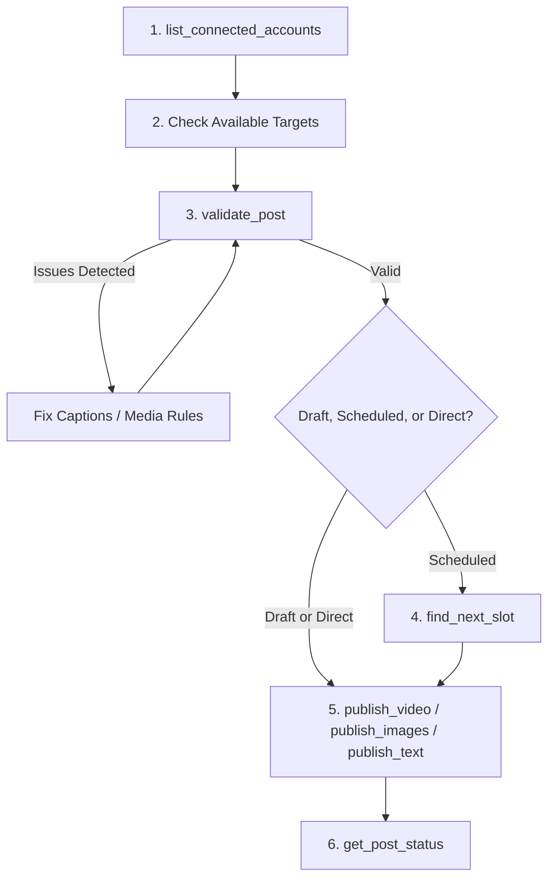

# PublishOnce Agent Skill

PublishOnce is a unified social media API and MCP-native automation platform designed for AI agents and developers. It supports multi-platform publishing across **16 platforms**, including native **LINE Official Account (Japan & Asia)**, **YouTube Shorts**, **TikTok**, **LinkedIn**, **Bluesky**, **Pinterest**, **X (Twitter)**, **Mastodon**, **WordPress**, **Telegram**, **Discord**, **Slack**, and **Instagram / Facebook / Threads / Google Business Profile**.

## Core Capabilities
1. **Multi-Platform Dispatch**: Simultaneously draft, publish, or schedule `video`, `image`, and `text` posts.
2. **Safe Draft Default (`publish_mode`)**: Defaults to `"draft"` (saves as draft / unlisted / container hold on supported platforms) unless `"direct"` is explicitly requested.
3. **Per-Platform Optimization (`caption_overrides` & `title_overrides`)**: Tailor copy, hashtags, and titles for each network in a single request.
4. **Algorithm-Friendly First Comments (`first_comment` & `follow_ups`)**: Keep external URLs out of the main post body and place them in the first comment automatically.
5. **Preflight Validation (`validate_post`)**: Pre-check character limits, video durations, aspect ratios, and platform rules before publishing.
6. **Smart Slot Discovery (`find_next_slot`)**: Locate the next synchronized open queue slot across connected accounts.
7. **Engagement & Analytics**: Fetch metrics, post history, comments, replies, and post statuses.

---

## Standard Workflow for Autonomous Agents (MCP)



### Step 1: Discover Active Accounts
Always call `list_connected_accounts` first to confirm which platforms and connection IDs are active.
- **Tool**: `list_connected_accounts`
- Note the returned `id` (UUID) and `platform` for each connected profile.

### Step 2: Preflight Validation
Run `validate_post` (or `validate_video` for video specs) before submitting to avoid platform limit errors.
- **Tool**: `validate_post`
- **Arguments**: `platforms` (array), `text` (caption), `media_type` (`"video"`, `"image"`, or `"none"`).

### Step 3: Find Optimal Time Slot (For Scheduling)
- **Tool**: `find_next_slot`
- **Arguments**: `platforms` or `connection_ids`.
- Returns `scheduled_at` (ISO 8601 UTC timestamp).

### Step 4: Draft, Publish, or Schedule
Choose the tool matching the content format:
- **Video**: `publish_video` / `schedule_video` (public `video_url` or uploaded path via `create_video_upload`)
- **Images (up to 20 depending on platform)**: `publish_images`
- **Text Only**: `publish_text`
- **Multi-Asset Campaign**: `publish_campaign`

Key optional parameters supported across publishing tools:
- `publish_mode`: `"draft"` (default, safe draft/hold mode) or `"direct"` (live publish/schedule).
- `caption_overrides`: Map of `{ "<platform>": "<custom caption>" }` to optimize copy per platform.
- `title_overrides`: Map of `{ "<platform>": "<custom title>" }` for platforms supporting titles (`youtube`, `pinterest`, `facebook`, `linkedin`).
- `first_comment`: Posted immediately after publishing on `youtube`, `instagram`, `facebook`, `threads`, `bluesky`, and `x`.
- `follow_ups`: Up to 4 additional thread/follow-up comments on `instagram`, `facebook`, `threads`, and `bluesky`.

### Step 5: Verify Post Execution
Query `get_post_status` using the returned `post_id` to inspect platform-by-platform status (`published`, `scheduled`, `draft`, `failed`) and permalinks.

---

## REST API Quick Reference

Base URL: `https://publishonce.app/api/v1`  
Authentication: `Authorization: Bearer <YOUR_API_KEY>`

- `GET /connections` — List connected social accounts
- `GET /platforms/capabilities` — Machine-readable capability matrix for all enabled platforms
- `GET /platforms/{platform}/requirements` — Video specs and field constraints per platform
- `POST /uploads` — Upload media before posting
- `POST /posts` — Create a draft, immediate post, or scheduled post

### Example: Multi-Platform Post with Per-Platform Copy & First Comment
```bash
curl -X POST "https://publishonce.app/api/v1/posts" \
  -H "Authorization: Bearer YOUR_API_KEY" \
  -H "Content-Type: application/json" \
  -d '{
    "post_type": "text",
    "publish_mode": "draft",
    "platforms": ["x", "linkedin", "bluesky"],
    "caption": "Publish and optimize across social platforms from one workflow.",
    "caption_overrides": {
      "x": "Stop copy-pasting across social apps. Optimize and schedule in one call.",
      "bluesky": "Multi-platform publishing with per-network copy and first-comment URLs.",
      "linkedin": "Streamlining multi-platform social publishing via REST API and MCP."
    },
    "first_comment": "Learn more: https://publishonce.app"
  }'
```
Set `"publish_mode": "direct"` only when you intend to publish or schedule live.

---

## Platform Availability & Constraints (16 Platforms)

### Immediately Available (12 Platforms)
| Platform | Post Types | Max Text | Max Images | Key Notes |
| :--- | :--- | :--- | :--- | :--- |
| **YouTube Shorts** | Video | 5,000 chars (title 100) | - | Supports `first_comment` and thumbnail image. |
| **TikTok** | Video | 2,200 chars | - | Supports `cover_frame` (`thumbnail_timestamp_ms`). |
| **LinkedIn** | Video, Image, Text | 3,000 chars | 20 | Supports Personal Profile & Company Page, `delete`. |
| **Bluesky** | Video, Image, Text | 300 chars | 4 (1MB ea) | Supports `first_comment`, `follow_ups`, `comments`, `insights`, `delete`. |
| **Pinterest** | Video, Image | 500 chars (title 100) | 5 | Requires `board_id`; supports `delete`. |
| **X (Twitter)** | Video, Image, Text | 280 chars | 4 (5MB ea) | Official quota (Free: 0, Starter: 20/mo, PRO: 40/mo, Enterprise: unlimited) or unlimited via BYOK. Supports `first_comment`. |
| **Mastodon** | Video, Image, Text | 500 chars | 4 (16MB ea) | Supports custom instances and `delete`. |
| **WordPress** | Video, Image, Text | 63,206 chars | 20 | REST API v2 Gutenberg blocks. |
| **LINE Official** | Video, Image, Text | 5,000 chars | 5 | Native Japan/Asia support; also works as notification target. |
| **Telegram** | Video, Image, Text | 4,096 chars | 10 | Channel/group posting via Chat ID; supports `delete`. |
| **Discord** | Video, Image, Text | 2,000 chars | 10 | Webhook/channel posting; supports `delete`. |
| **Slack** | Video, Image, Text | 5,000 chars | 5 | Incoming Webhook / Block Kit notification & posting. |

### Under Official Review (Test Accounts Only: 4 Platforms)
| Platform | Status | Post Types | Max Text | Key Notes |
| :--- | :--- | :--- | :--- | :--- |
| **Instagram Reels** | Meta App Review | Video, Image | 2,200 chars (10 images) | Supports `first_comment`, `follow_ups`, `comments`, `hide_comments`, `insights`. |
| **Facebook** | Meta App Review | Video, Image, Text | 63,206 chars (10 images) | Supports `first_comment`, `follow_ups`, `comments`, `insights`, `delete`. |
| **Threads** | Meta App Review | Video, Image, Text | 500 chars (20 images) | Supports `first_comment`, `follow_ups`, `comments`, `hide_comments`, `insights`, `delete`. |
| **Google Business** | Google Quota Review | Video, Image, Text | 1,500 chars (10 images) | Local business posts & media updates. |

---

## Best Practices for Agent Execution
1. **Never guess Connection IDs**: Always fetch real IDs from `list_connected_accounts`.
2. **Default to `publish_mode: "draft"`**: Keep `"draft"` when preparing content for user review; only pass `"direct"` when explicitly instructed to publish live.
3. **Use `first_comment` for URLs**: Keep external links out of the main caption on reach-sensitive networks (`x`, `instagram`, `facebook`, `threads`, `bluesky`, `youtube`).
4. **Use Human Review Links for High-Risk Campaigns**: Call `create_review_link` to generate an external approval link before final publication.
